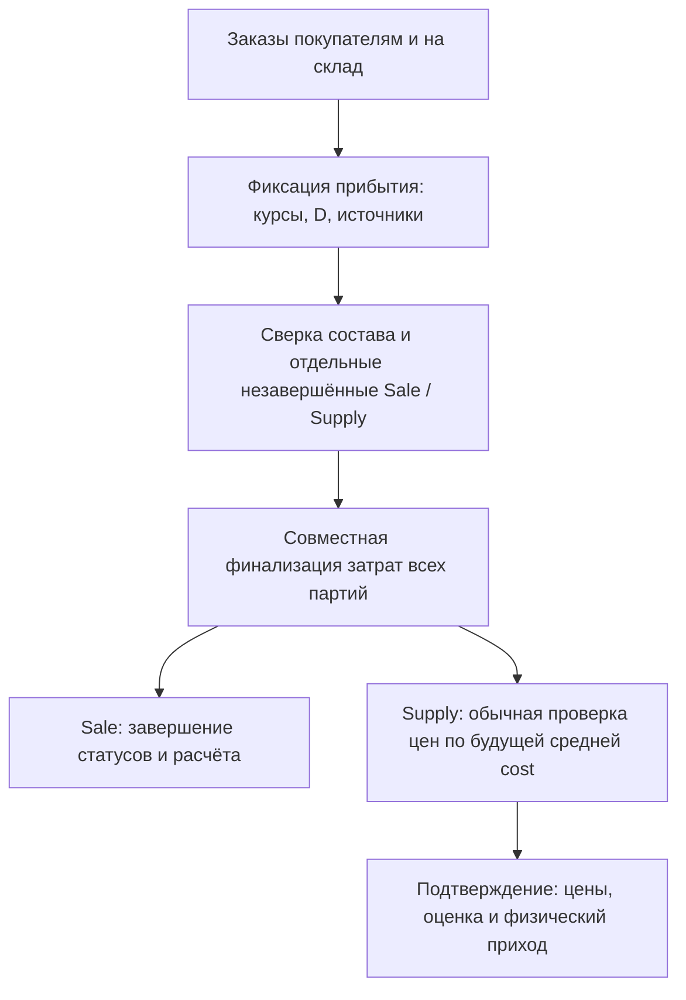

# Транзакции, повторы и внешние эффекты

## Уровни ответственности

| Уровень | Что обязан проверить | Чего недостаточно |
| --- | --- | --- |
| Шаблон/JS | Понятное действие, форма, фокус, подтверждение, текущая версия | Скрытая кнопка не запрещает прямой POST |
| View/form | Аутентификация, permissions, допустимый объект/ввод | Валидная форма не гарантирует наличие после параллельного списания |
| Сервис | Текущее состояние под блокировкой, расчёт, движение и аудит | Предпросмотр без повторной проверки не разрешает проведение |
| Model/DB | Согласованные поля, constraints, запрет недопустимого сохранения | `save()` без `full_clean()` не запускает все Python-валидаторы |
| on_commit/queue | Назначение внешней работы после успешной локальной транзакции | Наличие задания не подтверждает удалённый результат |
| Worker/API | Захват, лимиты, таймаут, подтверждение, retry и журнал | Успешный HTTP-запрос записи не всегда подтверждает целевое значение |

## Карта основных операций

| Операция | Каноническая точка входа | Согласованные изменения |
| --- | --- | --- |
| Продажа | `sales.services.create_sale` | Снимки строк, физический/реализационный источник, деньги/долг, аудит |
| Постоплата | `sales.services.mark_sale_paid` | Повторная проверка состояния, получено, debt delta, касса только для наличных |
| Отмена продажи | `sales.services.cancel_sale` | Возврат своих партий и денег, сторно своей долговой дельты |
| Принятие прихода | `supplies.services.confirm_supply_price_review` | Актуальность preview, средняя cost, цены, склад и аудит |
| Исправление принятого прихода | `supplies.services.revise_supply` | Версия, связанные основания оценки и история |
| Отмена прихода | `supplies.services.cancel_supply` | Количественные/стоимостные проверки без удаления истории |
| Реализация | `consignment.services` | Партия `stock_id`, физический источник, производный агрегат, история |
| Перемещение | `warehouse.services` | Источник, путь, получатель, сохранённая оценка и статус |
| Коррекция долга | `creditors.services.adjust_creditor_debt` | Баланс под блокировкой, журнал и выбранный денежный источник |
| Прибытие рейса | `orders.arrival` | Фиксация оснований, revision и точная общая доставка |
| Операция заказа | `orders.arrival_documents` | Подтверждение отклонений, источник строк, связь Sale/Supply, идемпотентность |
| Финализация рейса | `orders.arrival_finalization.finalize_arrival` | Все партии/документы одной транзакцией с сохранением контрольного итога |

Некоторые внутренние функции рассчитаны на уже открытую транзакцию. Например, `consume_consignment_sale_lines` и восстановление партий выполняются вызывающим сервисом продажи, который задаёт атомарность. Прямой вызов отдельного помощника в shell без изучения контракта небезопасен.

## Порядок операций рейса

До D документ существует, но его финальное проведение блокируется. D не заменяет G: это причина, по которой после финализации нужна отдельная страница проверки цен.

## Порядок и конкурентность

Для рейса применяется общий порядок: `SupplierOrderBatch` → `TripArrival` → его строки/документы. `lock_document_trip` вызывается перед денежным переходом связанной продажи. Это не позволяет завершить документ одновременно с изменением распределения затрат.

В частичном расчёте партнёра `Creditor` читается через `select_for_update()`, вычисление сверяется с подписанным preview, затем записывается одна дельта. Ранее показанный баланс не является достаточным основанием. Для SQLite дополнительно действуют IMMEDIATE-транзакции и ограниченная конкуренция одного writer: нельзя обещать поведение PostgreSQL row-locks только по наличию `select_for_update()`.

Ревизия формы защищает от потерянного обновления, а transaction/constraints — от частично проведённого состояния. Эти механизмы дополняют друг друга. При stale-ошибке нужно обновить расчёт; нельзя отключить проверку только для удобства старой вкладки.

## Что обеспечивает повтор

Идемпотентность создаётся ключами операций/receipt и проверкой состояний. Они существуют у продажи, отчёта реализации, дополнительных товаров рейса, строковых действий, денежных переводов, входящих событий и печати. Это не универсальная гарантия для любой новой функции.

Проверить отдельно: одинаковый ключ с теми же данными, тот же ключ с другими данными, два запроса одновременно, повтор после timeout и после отмены. Нельзя удалять receipt или сбрасывать флаг «оплачено», чтобы повторно вызвать старый сервис: это нарушает историю и уникальность финансовых операций.

## Три разных «подтверждения»

1. Подтверждение отклонений формы заказа от исходника подписывает именно текущий состав и условия.
2. Подтверждение взаиморасчёта защищает суммы/партнёра/баланс и ограничено временем. Явная продажа `partner_debt` и наличный ноль — предусмотренная отдельная ветка без такого диалога.
3. Подтверждение печати приходит от Windows-процесса, а не от нажатия браузерной кнопки.

Одинаковое слово в интерфейсе не разрешает переиспользовать один флаг для этих трёх событий.

## Отмена и снимки

Прямая отгрузка рейса не возвращается на физический склад, поскольку из него не списывалась. Для реализации возвращается конкретная исходная партия, а не первая найденная партия того же SKU. Долг сторнируется обратной дельтой к текущему балансу, сохраняя более поздние операции.

Штатный наличный возврат использует сумму связанной `sale_payment`. Поэтому произвольное дополнительное `deposit` с текстом номера продажи не становится автоматически её оплатой и не попадёт в полный возврат. Исправление уже завершённой продажи не поддерживается обычной формой редактирования постоплаты; это отдельная контролируемая процедура с копией, аудитом и проверкой отмены на изолированной БД.

## Внешние эффекты

`transaction.on_commit` откладывает назначение Avito/Sheets/ярлыков до commit. Откат транзакции не отменяет уже выполненный реальный HTTP или напечатанный ярлык. Поэтому сеть/печать не должны использоваться как пробный шаг, который потом якобы безопасно откатить SQLite rollback.

Неопределённая печать не повторяется автоматически: этикетка могла уже выйти. При timeout внешнего API сначала исследовать сохранённый job/remote state и существующий механизм безопасного повтора, а не вызывать действие вторично без ключа/проверки.
